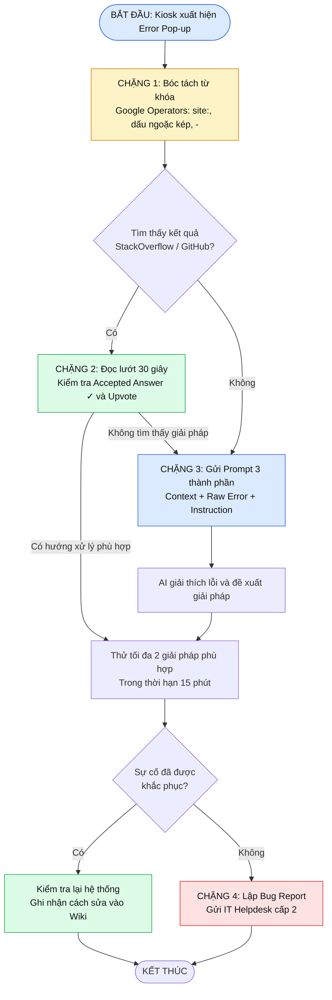

# Bài 10: Đánh Giá Đa Giải Pháp Quy Trình Khắc Phục Sự Cố Kỹ Thuật
## Phần 1: Lập bản so sánh Trade-off toàn diện
### 1. So sánh hai phương án xử lý sự cố
|Tiêu chí đánh giá	|Phương án 1: Hỗ trợ cảm tính / Nhóm Chat	|Phương án 2: Troubleshooting 4 Chặng|
|---|---|---|
|1. Thời gian xử lý sự cố (Downtime)	|Kéo dài, phụ thuộc vào việc Senior Dev có rảnh để trả lời hay không. Kỹ thuật viên phải chờ hỗ trợ từ tổng bộ.	|Rút ngắn đáng kể. Kỹ thuật viên có thể tự tra cứu và xử lý lỗi cơ bản trong 5–10 phút đầu tiên.|
|2. Áp lực và chi phí cho Senior Devs	|Rất cao. Senior Dev thường xuyên bị gián đoạn bởi những câu hỏi cơ bản, lặp đi lặp lại.	|Tối ưu. Senior Dev tập trung giải quyết những lỗi phức tạp thông qua Bug Report đầy đủ thông tin.|
|3. Năng lực và tính tự chủ của KTV	|Thụ động, phụ thuộc vào người khác, thiếu kỹ năng phân tích lỗi và dễ hoang mang trước thông báo tiếng Anh.	|Chủ động, có tư duy phân tích, biết tra cứu tài liệu và sử dụng AI để tự giải quyết sự cố.|
|4. Khả năng lưu vết tri thức (Knowledge Base)	|Thất thoát thông tin. Tin nhắn trên Zalo/Telegram dễ bị trôi, khó tìm kiếm và tái sử dụng.|	Lưu trữ tập trung. Các lỗi và cách khắc phục được tổng hợp thành tài liệu Wiki nội bộ để sử dụng lâu dài.|
### 2. Kết luận lựa chọn phương án
Ban Giám đốc VoltCharge bắt buộc nên lựa chọn Phương án 2 – Troubleshooting 4 Chặng Chuẩn hóa nếu muốn mở rộng quy mô từ 100 lên 1.000 trạm sạc.

Lý do:
1. **Giảm chi phí Downtime:** Mỗi giờ trạm sạc ngừng hoạt động gây thiệt hại 500.000 VNĐ. Việc giúp kỹ thuật viên tự xử lý lỗi cơ bản sẽ giảm thời gian chờ đợi và hạn chế thiệt hại kinh tế.
2. **Tối ưu nguồn lực nhân sự:** Giảm số lượng câu hỏi đơn giản gửi đến Senior Dev, giúp đội ngũ Backend tập trung phát triển tính năng mới và xử lý những vấn đề chuyên sâu.
3. **Nâng cao năng lực kỹ thuật viên:** Kỹ thuật viên có khả năng tự phân tích, tra cứu và xử lý sự cố thay vì phụ thuộc hoàn toàn vào người khác.
4. **Xây dựng kho tri thức doanh nghiệp:** Mỗi sự cố được giải quyết sẽ trở thành tài liệu tham khảo, giúp những nhân viên khác tránh lặp lại lỗi cũ.
## Phần 2: Thiết kế Sơ đồ Luồng Ra Quyết Định (Decision Flowchart)
### 1. Sơ đồ luồng quyết định gỡ lỗi 4 chặng
Quy trình xử lý khi Kiosk VoltCharge xuất hiện thông báo lỗi:
#### Luồng xử lý tổng quát

**Chặng 1: Google Operators – Tra cứu thông minh**

Kỹ thuật viên không tìm kiếm một cách tùy tiện mà phải bóc tách thông báo lỗi thành những từ khóa quan trọng.

Ba toán tử cần sử dụng:

|Toán tử	|Công dụng	|Ví dụ|
|---|---|---|
|`site:`|	Giới hạn kết quả trong một website	|`site:stackoverflow.com UnauthorizedAccessException`|
|`"..."`|	Tìm chính xác cụm từ	|`"Access is denied"`|
|`-`|	Loại bỏ kết quả không mong muốn|	`VoltCharge error -hardware`|

**Chặng 2: StackOverflow / GitHub – Thẩm định kết quả**

Khi tìm thấy bài viết liên quan, kỹ thuật viên cần:
- Đọc lướt khoảng 30 giây để xác định bài viết có cùng loại lỗi hay không.
- Ưu tiên câu trả lời có dấu tích xanh (Accepted Answer).
- Kiểm tra số lượng Upvote để tham khảo mức độ hữu ích.
- Kiểm tra phiên bản phần mềm, hệ điều hành và ngày đăng bài.
- Không sao chép lệnh về chạy ngay khi chưa hiểu tác dụng và rủi ro.

**Chặng 3: AI Assistant – Giải mã thông báo lỗi**

Nếu lỗi khó hiểu hoặc không tìm được hướng giải quyết phù hợp, sử dụng ChatGPT hoặc Gemini.

Áp dụng công thức Prompt 3 thành phần:
1. Context: Cung cấp thiết bị, hệ điều hành và tình huống xảy ra lỗi.
2. Raw Error: Sao chép nguyên văn thông báo lỗi sau khi che giấu thông tin bí mật.
3. Instruction: Yêu cầu AI dịch lỗi sang tiếng Việt, phân tích nguyên nhân và đưa ra hướng khắc phục.

**Chặng 4: Bug Report – Chuyển cấp hỗ trợ**

Nếu đã thử tối đa 2 giải pháp phù hợp nhưng vẫn thất bại sau 15 phút, kỹ thuật viên phải lập Bug Report gửi IT Helpdesk cấp 2.

Bug Report chuẩn gồm 4 bước:

|Thành phần	|Nội dung cần cung cấp|
|---|---|
|1. Environment|	Thiết bị, hệ điều hành, phiên bản phần mềm|
|2. Steps to Reproduce	|Các bước thực hiện khiến lỗi xuất hiện|
|3. Expected vs Actual Result	|Kết quả mong đợi và kết quả thực tế|
|4. Evidence & Actions Taken	|Ảnh chụp lỗi, Raw Error Log và những giải pháp đã thử|